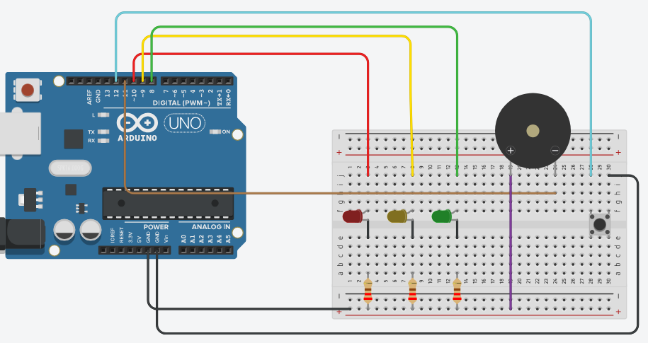

# Semáforo sonoro com Arduino

Semáforo com botão feito com Arduino Uno, três LEDs e um buzzer. Ao apertar o botão, o semáforo passa por amarelo e vermelho, e o buzzer apita enquanto o vermelho está aceso. Foi pensado como auxílio sonoro, para quem precisa de um aviso além da luz.

Projeto feito na disciplina de Robótica Computacional (Ciência da Computação, UPF) e montado no simulador Tinkercad.

## Como funciona

1. O semáforo fica com o **verde** aceso.
2. Ao apertar o botão, o verde apaga e o **amarelo** acende por 2 segundos.
3. O amarelo apaga e o **vermelho** acende por 5 segundos. Nesse tempo o buzzer apita (1000 Hz).
4. O vermelho apaga e o **amarelo** acende por mais 2 segundos.
5. O amarelo apaga e o **verde** volta. Se o botão ainda estiver apertado, o programa espera soltar antes de aceitar um novo aperto.

## Componentes

- 1 Arduino Uno
- 3 LEDs (vermelho, amarelo e verde), cada um com um resistor em série
- 1 buzzer
- 1 botão (push button)
- protoboard e fios

## Ligações

| Componente | Pino do Arduino |
|---|---|
| LED vermelho | 10 |
| LED amarelo | 9 |
| LED verde | 8 |
| Buzzer | 11 (o outro terminal no GND) |
| Botão | 12 (o outro terminal no GND) |

Os três LEDs têm o terminal negativo ligado ao GND por um resistor.

## Como executar

**No Tinkercad:** monte o circuito como na imagem, abra o editor de código, cole o conteúdo de `semaforo_sonoro/semaforo_sonoro.ino` e clique em *Start Simulation*.

**Na Arduino IDE:** abra o arquivo `semaforo_sonoro/semaforo_sonoro.ino` (a pasta e o arquivo precisam ter o mesmo nome), escolha a placa Arduino Uno e envie o programa.

## O que usei

- `pinMode`, `digitalWrite` e `digitalRead` para controlar LEDs e ler o botão
- `INPUT_PULLUP`, para ler o botão sem resistor externo
- confirmação do aperto do botão após 50 ms, para ignorar ruído
- `tone` e `noTone` para o buzzer
- `delay` para o tempo de cada luz e constantes para os pinos, tempos e frequência

## Possíveis melhorias

- apitar de forma intermitente (bip, bip), em vez de um som contínuo
- usar `millis()` no lugar de `delay`, para o programa continuar lendo o botão durante a sequência
- adicionar um semáforo de pedestres

## Outros repositórios

- [batalha-por-turnos](https://github.com/ffogasso/batalha-por-turnos): jogo de batalha no terminal, em Python
- [mini-sistemas-terminal](https://github.com/ffogasso/mini-sistemas-terminal): estoque, caixa eletrônico, calculadora, votação e notas
- [exercicios-python](https://github.com/ffogasso/exercicios-python): exercícios de decisão, repetição e funções

## Sobre

Feito por Filipe Fogasso Torella, estudante de Ciência da Computação na UPF.
